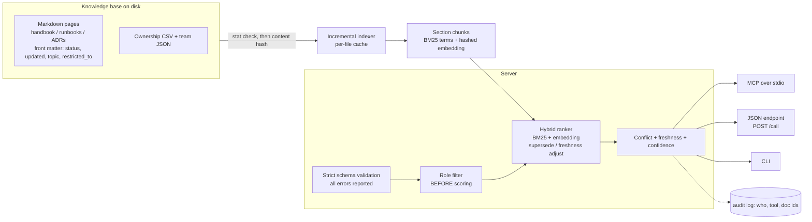

# internal-context-mcp

A small, offline **internal context server** for AI agents and employees, exposed over the Model Context Protocol (MCP) and a plain JSON endpoint. It answers questions from a company knowledge base and tells the caller *where the answer came from, how old it is, whether it conflicts with something else, and whether they were even allowed to see it*.

Everything here is a prototype over a **synthetic** knowledge base for a fictional company ("Northwind Labs"). No network access, model download or API key is needed to build, test or run it.

## Problem

Agents that answer company questions fail in boring, expensive ways:

- they quote a policy that was **superseded** a year ago;
- two documents **disagree** and the agent silently picks one;
- they leak a **restricted** page to someone outside the owning team;
- they answer confidently when nothing relevant exists;
- the index is **stale** because re-indexing is all-or-nothing.

This prototype makes each of those a first-class, testable behaviour rather than a prompt instruction.

## Architecture



```
request -> validate (JSON Schema subset, additionalProperties:false)
        -> resolve role (deployment-locked, or argument)
        -> refresh index if files changed (stat -> sha256 -> re-chunk only that file)
        -> filter docs by role  (restricted chunks never enter ranking)
        -> score = BM25 and hashed-embedding cosine, demote superseded / stale
        -> attach freshness, confidence, conflicts -> respond (+ audit line)
```

### Retrieval

- **BM25** over section-level chunks (title and heading are included in each chunk's terms).
- **Lightweight embedding**: a deterministic hashed bag of word stems, character trigrams and a small hand-written concept lexicon (about 17 groups such as pay/salary/compensation), L2-normalised into 1024 dimensions. It is not a learned model; it only adds some paraphrase tolerance and runs entirely offline.
- **Hybrid** relevance = `0.55 * bm25_fraction + 0.45 * cosine`. Superseded docs are multiplied by 0.5, stale ones by 0.92, aging ones by 0.97. Nothing is hidden by default; superseded docs are demoted and flagged.

### Knowledge base (`kb/`, generated by `npm run generate-kb`)

41 Markdown documents plus 2 ownership files:

| Kind | Count | Notes |
| --- | --- | --- |
| Handbook pages | 12 | includes a superseded travel page and a superseded remote-access policy |
| Runbooks | 11 | one per service, plus incident response, database failover, certificate rotation |
| Service overviews | 8 | one per service |
| ADRs | 4 | one superseded by a later ADR |
| Restricted docs | 6 | restricted to teams: hr, finance, security, payments, platform |
| Ownership | 2 | `services.csv`, `teams.json` (indexed as documents too) |

Deliberate problems the server must handle:

- **Active disagreement**: the on-call policy page says escalate after 30 minutes; the incident runbook says 15. Both are active, they share `topic: oncall-escalation`.
- **Superseded**: the old remote-access policy points to the zero-trust policy; the 2023 travel rules point to the expense policy; ADR-0002 points to ADR-0006.
- **Ownership mismatch**: the ownership table says one team owns `notification-svc`, the service overview names another.
- **Stale**: the staging guide (2022) and incident-response runbook (2024) are old relative to the reference date.

## Tools

All tools take a strict input schema (`additionalProperties: false`). Every tool accepts an optional `role`; see "Permissions".

| Tool | Purpose |
| --- | --- |
| `search_context` | Ranked sections with doc id, section, last-updated, freshness, status, confidence; plus `conflicts`. |
| `get_document` | One document or one section by id. Restricted docs the caller cannot read look exactly like a missing id. |
| `who_owns` | Owning team, lead, on-call alias, channel, tier for a service, with the source row and any disagreeing doc. |
| `answer_with_sources` | Extractive answer from retrieved snippets, with `status`: `answered`, `answered_with_conflict` or `insufficient_evidence`. No text generation. |
| `reindex` | Incremental re-scan (admin only). `request_id` makes retries idempotent. |

### Example: `answer_with_sources` on a real conflict

Request:

```json
{ "question": "When does an unacknowledged page escalate to the secondary on-call?", "max_sources": 2 }
```

Response (trimmed):

```json
{
  "status": "answered_with_conflict",
  "answer": null,
  "answer_note": "Sources disagree; no single answer is asserted. See conflicts and sources.",
  "sources": [
    { "ref": 1, "doc_id": "hb-oncall-policy", "section": "Escalation timing",
      "snippet": "If the primary on-call has not acknowledged a page within 30 minutes, the page escalates to the secondary ...",
      "last_updated": "2026-09-20", "freshness": "fresh", "status": "active", "confidence": "medium", "in_conflict": true },
    { "ref": 2, "doc_id": "rb-incident-response", "section": "Escalation timing",
      "snippet": "If the primary on-call has not acknowledged within 15 minutes, page the secondary on-call ...",
      "last_updated": "2024-06-02", "freshness": "stale", "status": "active", "confidence": "medium", "in_conflict": true }
  ],
  "conflicts": [
    { "kind": "active_disagreement", "topic": "oncall-escalation",
      "note": "2 active documents cover \"oncall-escalation\" and may disagree. The most recently updated is hb-oncall-policy (2026-09-20); verify with the owning team before acting." }
  ],
  "warnings": [ "[2] rb-incident-response was last updated 2024-06-02 (882 days ago)." ]
}
```

### Example: `who_owns`

```json
{ "service": "notification-svc" }
```
```json
{
  "service": "notification-svc", "owning_team": "growth", "team_lead": "Priya Raman",
  "oncall_alias": "growth-oncall", "channel": "#growth-eng", "tier": 2,
  "source": { "doc_id": "ownership-services", "section": "notification-svc", "last_updated": "2026-09-30", "freshness": "fresh" },
  "confidence": "medium",
  "conflicts": [ { "doc_id": "svc-notification-svc", "claimed_owner": "platform",
    "note": "svc-notification-svc says platform; the ownership table says growth. The table is the system of record, but confirm with #growth-eng." } ]
}
```

### Example: rejected call

```json
{ "query": "x", "k": 99 }
```
```json
{ "error": { "code": "INVALID_ARGUMENTS",
  "message": "Invalid arguments for search_context:\n- arguments.query: must be at least 2 characters\n- arguments.k: must be <= 20" } }
```

Error codes: `INVALID_ARGUMENTS`, `PERMISSION_DENIED`, `NOT_FOUND`, `UNKNOWN_TOOL`. Over MCP they are returned as `isError: true` tool results; over HTTP they map to 400, 403, 404, 404.

## Permissions

Each document may carry `restricted_to: [team, ...]`. A caller has one role: `employee` (default), a team name, or `admin`. A restricted doc is readable only by listed teams and `admin`.

- Filtering happens **before ranking**, so restricted text cannot appear in a snippet, a conflict note or a score.
- `get_document` for a hidden id returns the same `NOT_FOUND` as a nonexistent id.
- Conflict detection only considers documents the caller can read.
- If the server is started with `--role <role>` (or `CONTEXT_CALLER_ROLE`), the role is **locked**; a call that passes a different `role` is rejected. In a real deployment the role must come from an authenticated identity, not from the request. The `role` argument exists so the prototype and its tests can exercise every role.

## Freshness, confidence, conflicts

- `freshness`: `fresh` (180 days or less since `updated`), `aging` (up to 365), `stale` (older). Reference date is `CONTEXT_NOW` / `--now`, defaulting to the current time, so results are reproducible.
- `confidence` (per source): `low` if superseded or relevance is weak; `medium` if stale or in a conflict; otherwise `high` when relevance is solid. Thresholds are hand-set, not calibrated.
- Conflicts are declared through a shared `topic` in front matter: two or more *active* readable docs with the same topic are reported as `active_disagreement`; a superseded doc is reported with its successor. The server does not read the text to detect contradictions.
- `answer_with_sources` returns `insufficient_evidence` when the best section is below a relevance floor.

## Incremental re-index

`ContextIndex.reindex()` compares each file's size and mtime to a per-file cache, hashes the content only when those differ, and re-chunks/re-embeds only files whose hash changed. It reports `added`, `changed`, `removed`, `unchanged` and how many files were actually parsed. The cache is a single JSON file (`.context-index/index.json`), so a restarted process skips unchanged files.

- Tool calls re-scan automatically when more than 2 seconds have passed since the last scan, so edits are visible without a restart.
- `context-mcp reindex --watch` polls and prints changes.
- The `reindex` tool is admin-only and idempotent per `request_id`.

## Run it

Requires Node 18 or newer.

```bash
npm install
npm run build
npm test                    # build and run all tests
npm run eval                # print hit@k per retrieval mode
node dist/src/cli.js search "paid time off"
node dist/src/cli.js call who_owns '{"service":"billing-api"}'
node dist/src/cli.js reindex --watch
```

CLI options: `--kb <dir>`, `--cache <file>`, `--role <role>`, `--audit <file>`, `--now <date>`; run `node dist/src/cli.js help`.

### Plug into an MCP client (stdio)

Generic client configuration; adapt the key names to your client:

```json
{
  "mcpServers": {
    "internal-context": {
      "command": "node",
      "args": ["/path/to/internal-context-mcp/dist/src/cli.js", "mcp", "--kb", "/path/to/internal-context-mcp/kb", "--role", "employee"],
      "env": { "CONTEXT_AUDIT_LOG": "/path/to/audit.jsonl" }
    }
  }
}
```

### Call it from a generic workflow tool (HTTP)

```bash
node dist/src/cli.js serve-http --port 8787            # loopback only by default
# off loopback the server refuses to start unless CONTEXT_HTTP_AUTH is set
```

| Route | Description |
| --- | --- |
| `GET /health` | `{ "ok": true }` |
| `GET /tools` | tool names, descriptions and JSON Schemas |
| `POST /call` | body `{ "tool": "...", "arguments": { ... } }`, returns `{ "ok": true, "result": ... }` |

Any tool that can send an HTTP request with a JSON body (a "webhook" or "HTTP request" step) can use it:

```bash
curl -s localhost:8787/call -H 'Content-Type: application/json' \
  -d '{"tool":"answer_with_sources","arguments":{"question":"How many days of paid time off do I get?"}}'
```

Bodies are limited to 64 KB. When `CONTEXT_HTTP_AUTH` is set, send `Authorization: Bearer <that value>`. Branch on `result.status` (`answered`, `answered_with_conflict`, `insufficient_evidence`) in the workflow to route conflicts or gaps to a human.

## Tests and evaluation

`npm test` compiles TypeScript and runs 20 tests with `node:test`:

- schema rejection (a dozen kinds of bad input, with multiple errors reported together);
- permission filtering (search, `get_document`, answers, locked role, admin-only `reindex`);
- conflict surfacing (active disagreement, superseded demotion, stale flags, abstention, ownership mismatch);
- incremental re-index (no-op rerun, single-file re-parse, add/change/remove report, content-hash check on touched files, persisted cache, `request_id` dedupe);
- retrieval quality on the labelled question set;
- MCP client/server round trip and the HTTP endpoint (status codes, bearer check).

### Retrieval numbers (real run, `npm run eval`)

38 labelled questions (`eval/questions.json`) with reference date 2026-11-01. A hit means any acceptable doc id is in the top *k* distinct documents for the caller's role. Eight of the questions are deliberately low-overlap paraphrases. Four additional questions check that restricted docs never appear for roles without access (**0 leaks**).

| Mode | hit@1 | hit@3 | hit@5 | MRR |
| --- | --- | --- | --- | --- |
| BM25 only | 0.842 | 0.974 | 0.974 | 0.899 |
| Embedding only | 0.789 | 0.921 | 0.974 | 0.863 |
| Hybrid (default) | 0.868 | 0.921 | 0.974 | 0.904 |

How to read this honestly: the question set is small, written by the same author as the knowledge base, and the knowledge base is small (137 chunks), so these are smoke-test numbers, not a benchmark. Hybrid wins on hit@1 and MRR but does not beat BM25 on hit@3. The misses are three low-overlap paraphrases (a stolen phone, "based overseas", "time back after carrying the pager"), which the tiny concept lexicon does not cover. A learned embedding model would be the obvious next step; it was left out to keep the prototype offline and dependency-free.

## Limitations and what to harden next

- **Authentication**: the role is an argument or a startup flag. Production needs identity from the transport (verified claims mapped to groups), and the endpoint needs real per-caller credentials instead of one shared bearer value.
- **Connectors**: only local files are read. Real use needs connectors for wikis, ticket trackers, chat and drives that carry source ACLs through to `restricted_to`, plus webhooks or change feeds instead of polling.
- **Conflict detection** relies on authored `topic` front matter. It does not detect contradictions in text, and a topic mistake produces false or missing conflicts.
- **Embedding** is a hashed lexical-plus-lexicon vector, not a semantic model; paraphrase recall is limited (see misses above).
- **Existence leaks**: hidden documents are indistinguishable from missing ones, but timing and ranking noise were not analysed.
- **Audit**: the log records timestamp, tool, role, outcome and doc ids served (not queries). It is a plain append-only file with no integrity protection or retention policy.
- **Prompt injection**: documents are returned as data and the server instructions say so, but nothing sanitises document text.
- **Scale**: the index is held in memory and persisted as one JSON file; fine for thousands of sections, not millions.
- **Confidence** thresholds and freshness windows are hand-set and untuned; there are no production metrics behind them.
- **Concurrency**: one process, synchronous index updates.

## Provenance

The strict validation approach (every violation reported, unknown fields rejected), the request-id deduplication of retried writes, and the test layout were adapted from an earlier schema-validated tool bridge I wrote. The per-file change detection idea (cheap stat check, then content hash, cache per file) was adapted from an earlier incremental code-graph CLI. Both were re-implemented here in TypeScript for a different domain; no code was copied verbatim.
