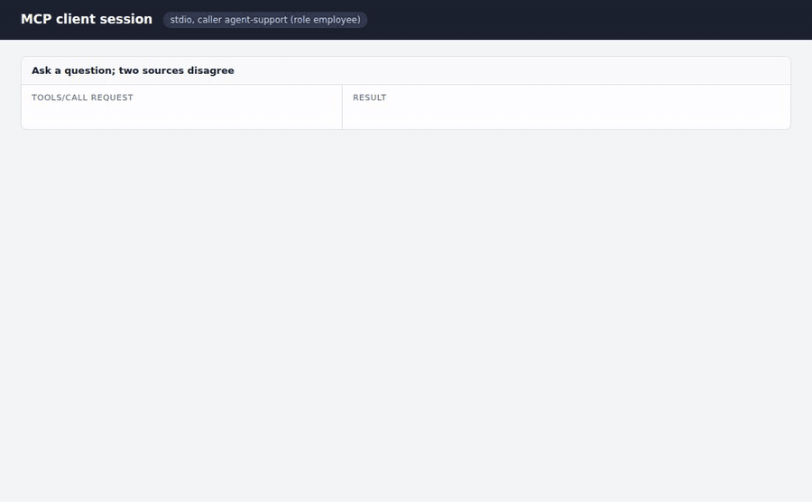
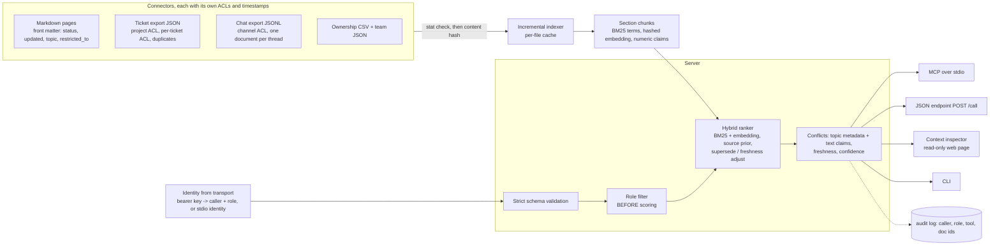
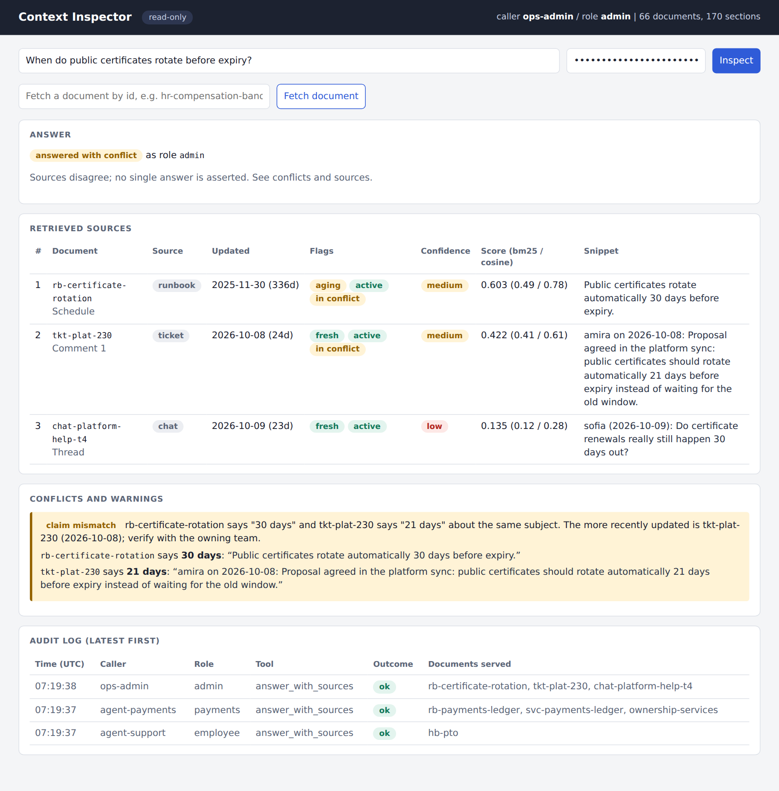
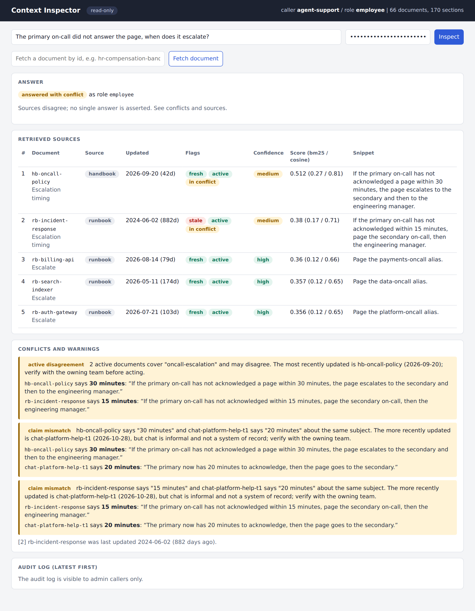
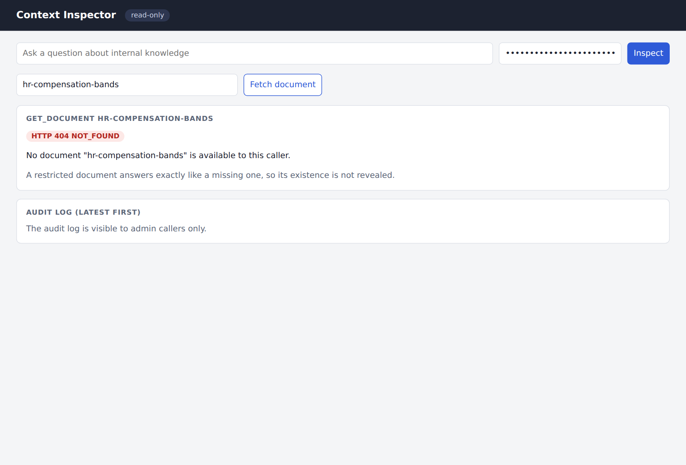
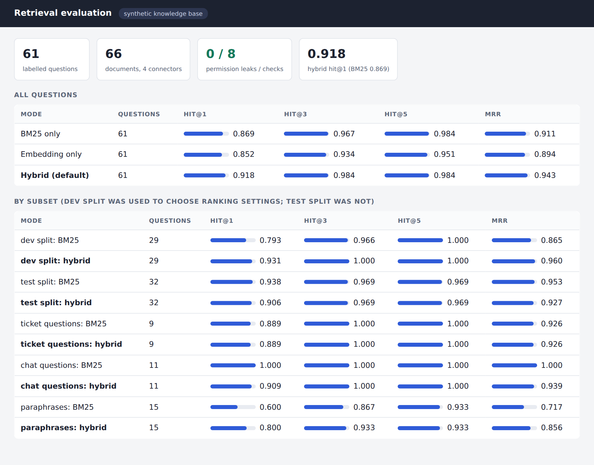
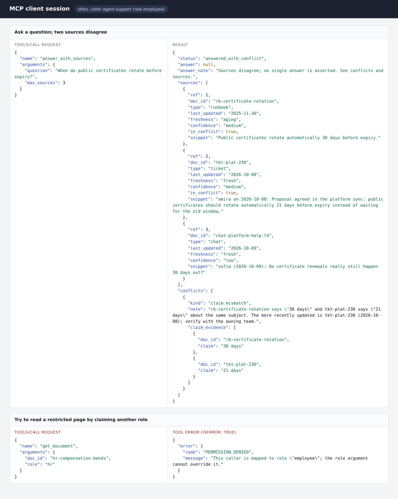

# internal-context-mcp



*About 20 seconds, recorded from the real server: an MCP session over stdio, then the read-only context inspector (conflict flags, a denied restricted page, then an admin reading the audit log). [MP4 version](docs/demo.mp4). Re-record with `npm run docs`.*

A small, offline **internal context server** for AI agents and employees, exposed over the Model Context Protocol (MCP) and a plain JSON endpoint. It indexes **Markdown pages, a ticket export and a chat export** behind a connector interface and answers questions with *where the answer came from, how old it is, whether sources conflict (including numeric claims found in the text), and whether the caller was even allowed to see it*. Caller identity comes from the transport, not from the request.

Everything here is a prototype over a **synthetic** knowledge base for a fictional company ("Northwind Labs"). No network access, model download or API key is needed to build, test or run it.

## Problem

Agents that answer company questions fail in boring, expensive ways:

- they quote a policy that was **superseded** a year ago;
- two documents **disagree** and the agent silently picks one;
- they leak a **restricted** page to someone outside the owning team;
- they answer confidently when nothing relevant exists;
- the index is **stale** because re-indexing is all-or-nothing.

This prototype makes each of those a first-class, testable behaviour rather than a prompt instruction.

## Architecture



```
request -> authenticate (HTTP: caller key -> id + role; stdio: configured identity)
        -> validate (JSON Schema subset, additionalProperties:false)
        -> role = identity role (a role argument may only repeat it)
        -> refresh index if files changed (stat -> sha256 -> re-parse only that file)
        -> filter docs by role  (restricted chunks never enter ranking)
        -> score = BM25 and hashed-embedding cosine, demote superseded / stale, informal sources
        -> attach freshness, confidence, conflicts -> respond (+ audit line)
```

### Connectors

A connector turns one kind of file into documents (`src/connectors.ts`); everything downstream is source-agnostic.

| Connector | Files | What it carries |
| --- | --- | --- |
| Markdown | `kb/**/*.md` | front matter: status, updated, `superseded_by`, `topic`, `restricted_to` |
| Tickets | `kb/tickets/*.json` | one document per ticket; project-level ACL with optional per-ticket `restricted_to`; description plus comments as sections; a ticket closed as duplicate is flagged superseded |
| Chat | `kb/chat/*.jsonl` | one document per thread; channel-level ACL; timestamps from the last message |
| Ownership | `kb/ownership/*` | service table and team directory, used by `who_owns` |

All four are indexed incrementally by the same per-file cache: appending one chat message re-parses one file.

### Retrieval

- **BM25** over section-level chunks (title and heading are included in each chunk's terms).
- **Lightweight embedding**: a deterministic hashed bag of word stems, character trigrams and a small hand-written concept lexicon (about 22 groups such as pay/salary/compensation, lost/stolen, duplicate/twice), L2-normalised into 1024 dimensions. It is not a learned model; it only adds some paraphrase tolerance and runs entirely offline.
- **Hybrid** relevance = `0.55 * bm25_fraction + 0.45 * cosine`. Superseded docs are multiplied by 0.5, stale ones by 0.92, aging ones by 0.97, and informal sources get a source prior (chat 0.7, ticket 0.85) so a chat message does not outrank the handbook on similar relevance. Nothing is hidden by default; demoted docs are flagged.

### Knowledge base (`kb/`, generated by `npm run generate-kb`)

Synthetic company "Northwind Labs": 41 Markdown pages (12 handbook, 11 runbooks, 8 service overviews, 4 ADRs, 6 restricted to hr, finance, security, payments or platform), 2 ownership files, **11 tickets** in 5 project exports and **12 chat threads** in 6 channel exports (the payments, security and people-ops channels and the PAY and HR projects are ACL-restricted). Deliberate problems: on-call escalation stated as 30 minutes (handbook), 15 (runbook) and 20 (chat); certificate rotation 30 days (runbook) vs 21 (ticket); superseded VPN, travel and ADR pages and a duplicate ticket; a service overview naming a different owner than the ownership table; stale pages.

## Tools

All tools take a strict input schema (`additionalProperties: false`). Every tool accepts an optional `role`, honoured only for an unauthenticated local caller and otherwise required to match the authenticated identity; see "Permissions and identity".

| Tool | Purpose |
| --- | --- |
| `search_context` | Ranked sections with doc id, section, last-updated, freshness, status, confidence; plus `conflicts`. |
| `get_document` | One document or one section by id. Restricted docs the caller cannot read look exactly like a missing id. |
| `who_owns` | Owning team, lead, on-call alias, channel, tier for a service, with the source row and any disagreeing doc. |
| `answer_with_sources` | Extractive answer from retrieved snippets, with `status`: `answered`, `answered_with_conflict` or `insufficient_evidence`. No text generation. |
| `reindex` | Incremental re-scan (admin only). `request_id` makes retries idempotent. |

### Example: `answer_with_sources` on a real conflict

Request:

```json
{ "question": "When does an unacknowledged page escalate to the secondary on-call?", "max_sources": 2 }
```

Response (trimmed):

```json
{
  "status": "answered_with_conflict",
  "answer": null,
  "answer_note": "Sources disagree; no single answer is asserted. See conflicts and sources.",
  "sources": [
    { "ref": 1, "doc_id": "hb-oncall-policy", "section": "Escalation timing",
      "snippet": "If the primary on-call has not acknowledged a page within 30 minutes, the page escalates to the secondary ...",
      "last_updated": "2026-09-20", "freshness": "fresh", "status": "active", "confidence": "medium", "in_conflict": true },
    { "ref": 2, "doc_id": "rb-incident-response", "section": "Escalation timing",
      "snippet": "If the primary on-call has not acknowledged within 15 minutes, page the secondary on-call ...",
      "last_updated": "2024-06-02", "freshness": "stale", "status": "active", "confidence": "medium", "in_conflict": true }
  ],
  "conflicts": [
    { "kind": "active_disagreement", "topic": "oncall-escalation",
      "note": "2 active documents cover \"oncall-escalation\" and may disagree. The most recently updated is hb-oncall-policy (2026-09-20); verify with the owning team before acting." }
  ],
  "warnings": [ "[2] rb-incident-response was last updated 2024-06-02 (882 days ago)." ]
}
```

### Example: `who_owns`

```json
{ "service": "notification-svc" }
```
```json
{
  "service": "notification-svc", "owning_team": "growth", "team_lead": "Priya Raman",
  "oncall_alias": "growth-oncall", "channel": "#growth-eng", "tier": 2,
  "source": { "doc_id": "ownership-services", "section": "notification-svc", "last_updated": "2026-09-30", "freshness": "fresh" },
  "confidence": "medium",
  "conflicts": [ { "doc_id": "svc-notification-svc", "claimed_owner": "platform",
    "note": "svc-notification-svc says platform; the ownership table says growth. The table is the system of record, but confirm with #growth-eng." } ]
}
```

### Example: rejected call

```json
{ "query": "x", "k": 99 }
```
```json
{ "error": { "code": "INVALID_ARGUMENTS",
  "message": "Invalid arguments for search_context:\n- arguments.query: must be at least 2 characters\n- arguments.k: must be <= 20" } }
```

Error codes: `INVALID_ARGUMENTS`, `PERMISSION_DENIED`, `NOT_FOUND`, `UNKNOWN_TOOL`. Over MCP they are returned as `isError: true` tool results; over HTTP they map to 400, 403, 404, 404.

## Permissions and identity

Each document may carry `restricted_to: [team, ...]` (for tickets and chat this comes from the export's ACL). A caller has one role: `employee`, a team name, or `admin`. A restricted doc is readable only by listed teams and `admin`.

- **HTTP**: callers present `Authorization: Bearer <caller key>`. The server looks the key up (by SHA-256, constant-time compare) in an identity config and uses *that caller's* role. A `role` argument may only repeat the caller's own role; asking for a different one is `PERMISSION_DENIED` and is audited. Unknown or missing keys get 401.
- **stdio**: the launcher names the identity (`--as agent-support --identities <file>`); the process is bound to it for its lifetime.
- **Identity config**: `context-mcp identity init --out identities.local.json` generates caller keys at runtime, prints them once, and stores only hashes. `*.local.json` is gitignored.
- Filtering happens **before ranking**, so restricted text cannot appear in a snippet, a conflict note, a claim or a score. `get_document` for a hidden id returns the same `NOT_FOUND` as a nonexistent id. Conflict and claim detection only consider documents the caller can read.
- Without `--identities` (local development only) the role is a free argument or `--role` locks it. Off loopback the HTTP server refuses to start without identities.
- The audit log (`--audit <file>`) records timestamp, **caller id**, role, tool, outcome and doc ids served (not queries).

## Freshness, confidence, conflicts

- `freshness`: `fresh` (180 days or less since `updated`), `aging` (up to 365), `stale` (older). Reference date is `CONTEXT_NOW` / `--now`, so results are reproducible.
- `confidence` (per source): `low` if superseded or relevance is weak; `medium` if stale or in a conflict; otherwise `high` when relevance is solid. Thresholds are hand-set, not calibrated.
- Conflicts come from three places:
  1. `active_disagreement`: two or more active readable docs share a front-matter `topic`.
  2. `superseded`: a superseded doc is reported with its successor (also for tickets closed as duplicates).
  3. `claim_mismatch` (new): **text-based**. At index time each section is scanned for duration and percentage claims ("30 days", "15 minutes", "two weeks"), normalised to one unit. A result document's claim is compared with claims in every other readable, active document, whatever its source or topic metadata; two claims conflict when they have different values and share enough subject words (overlap coefficient at least 0.6). Evidence (the two sentences) is returned. When the same two documents already share a topic conflict, the claim evidence is attached to it instead of duplicating it.
- In `answer_with_sources`, only sources close to the best match (at least 0.6 of the top relevance) drive conflict detection, so a loosely related page does not raise a false alarm.
- `answer_with_sources` returns `insufficient_evidence` when the best section is below a relevance floor.

Real example from the synthetic data: the certificate runbook says public certificates rotate 30 days before expiry, a ticket says the plan is 21 days, and chat says the automation still uses the old window. No topic metadata links them; the text claim does. A three-way on-call disagreement (30 minutes in the handbook, 15 in the runbook, 20 in chat) is reported with all pairs.

## Incremental re-index

`ContextIndex.reindex()` compares each file's size and mtime to a per-file cache, hashes the content only when those differ, and re-chunks/re-embeds only files whose hash changed. It reports `added`, `changed`, `removed`, `unchanged`, how many files were actually parsed and documents per connector. The cache is a single JSON file (`.context-index/index.json`), so a restarted process skips unchanged files.

- Tool calls re-scan automatically when more than 2 seconds have passed since the last scan, so edits are visible without a restart.
- `context-mcp reindex --watch` polls and prints changes.
- The `reindex` tool is admin-only and idempotent per `request_id`.

## Run it

Requires Node 18 or newer.

```bash
npm install
npm run build
npm test                    # build and run all tests
npm run eval                # print hit@k per retrieval mode, subsets and leak checks
npm run docs                # re-record screenshots and docs/demo.gif (needs Chrome and an ffmpeg binary)
node dist/src/cli.js search "paid time off"
node dist/src/cli.js call who_owns '{"service":"billing-api"}'
node dist/src/cli.js identity init --out identities.local.json   # prints caller keys once; stores hashes
node dist/src/cli.js reindex --watch
```

CLI options: `--kb <dir>`, `--cache <file>`, `--identities <file>`, `--as <id>`, `--role <role>`, `--audit <file>`, `--now <date>`; run `node dist/src/cli.js help`. `npm run generate-kb` regenerates the synthetic knowledge base, including the ticket and chat exports.

### Plug into an MCP client (stdio)

Generic client configuration; adapt the key names to your client. The server is bound to the named caller identity:

```json
{
  "mcpServers": {
    "internal-context": {
      "command": "node",
      "args": ["/path/to/internal-context-mcp/dist/src/cli.js", "mcp", "--kb", "/path/to/internal-context-mcp/kb",
               "--identities", "/path/to/identities.local.json", "--as", "agent-support"],
      "env": { "CONTEXT_AUDIT_LOG": "/path/to/audit.jsonl" }
    }
  }
}
```

### Call it from a generic workflow tool (HTTP)

```bash
node dist/src/cli.js serve-http --port 8787 --identities identities.local.json --audit audit.jsonl --inspector
# off loopback the server refuses to start without --identities
```

| Route | Description |
| --- | --- |
| `GET /health` | `{ "ok": true }` (no key needed) |
| `GET /tools` | tool names, descriptions and JSON Schemas |
| `POST /call` | body `{ "tool": "...", "arguments": { ... } }`, returns `{ "ok": true, "result": ... }` |
| `GET /inspector` | read-only context inspector page (with `--inspector`); its data routes `/inspect?q=` and `/audit` need a caller key, and `/audit` is admin only |

Any tool that can send an HTTP request with a JSON body (a "webhook" or "HTTP request" step) can use it:

```bash
curl -s localhost:8787/call -H 'Content-Type: application/json' -H "Authorization: Bearer $CALLER_KEY" \
  -d '{"tool":"answer_with_sources","arguments":{"question":"How many days of paid time off do I get?"}}'
```

Bodies are limited to 64 KB. Branch on `result.status` (`answered`, `answered_with_conflict`, `insufficient_evidence`) in the workflow to route conflicts or gaps to a human.

## Screenshots

All captured from the running server by `npm run docs` (synthetic data, callers and keys generated at runtime).



*The inspector as an admin caller: three connectors' sources, a text-derived 30 days vs 21 days conflict, BM25/cosine signals per source, and the audit trail.*



*A three-way on-call disagreement (30, 15 and 20 minutes) is reported, not resolved; chat is marked informal. An employee caller cannot read the audit log.*



*A restricted page looks exactly like a missing one to a caller without access.*



*The evaluation table rendered from `npm run eval` output, including the dev/test split and ticket/chat subsets.*



*A real MCP client over stdio: a conflict answer with claim evidence, then a `PERMISSION_DENIED` when the caller tries to claim another role.*

## Tests and evaluation

`npm test` compiles TypeScript and runs 26 tests with `node:test`:

- schema rejection (a dozen kinds of bad input, with multiple errors reported together);
- permission filtering (search, `get_document`, answers, locked role, admin-only `reindex`);
- identity: per-caller keys map to roles over HTTP, a role argument cannot widen them, the audit route is admin only, a bound stdio caller cannot override its role;
- connectors: ticket and chat ACLs, duplicate tickets flagged superseded, incremental pick-up of a new chat line and a new ticket file;
- conflict surfacing (topic disagreement, text-claim mismatch across runbook and ticket, claims never revealing a restricted document, superseded demotion, stale flags, abstention, ownership mismatch);
- incremental re-index (no-op rerun, single-file re-parse, add/change/remove report, content-hash check, persisted cache, `request_id` dedupe);
- retrieval quality on the labelled question set;
- MCP client/server round trip and the HTTP endpoint.

### Retrieval numbers (real run, `npm run eval`)

61 scored questions (`eval/questions.json`, reference date 2026-11-01), 66 documents from three kinds of source (Markdown, ticket JSON, chat JSONL, plus the ownership table). 11 questions are answered by chat threads, 9 by tickets, 15 are paraphrases. Eight further checks assert that restricted docs never appear for roles without access (**0 leaks**). A hit means any acceptable doc id is in the top *k* distinct documents for the caller's role.

| Mode | hit@1 | hit@3 | hit@5 | MRR |
| --- | --- | --- | --- | --- |
| BM25 only | 0.869 | 0.967 | 0.984 | 0.911 |
| Embedding only | 0.852 | 0.934 | 0.951 | 0.894 |
| Hybrid (default) | 0.918 | 0.984 | 0.984 | 0.943 |

All modes share the same status, freshness and source-prior multipliers.

| Subset | n | BM25 hit@1 / hit@3 / MRR | Hybrid hit@1 / hit@3 / MRR |
| --- | --- | --- | --- |
| dev split (used to pick settings) | 29 | 0.793 / 0.966 / 0.865 | 0.931 / 1.000 / 0.960 |
| **test split (not used for tuning)** | 32 | 0.938 / 0.969 / 0.953 | 0.906 / 0.969 / 0.927 |
| ticket questions | 9 | 0.889 / 1.000 / 0.926 | 0.889 / 1.000 / 0.926 |
| chat questions | 11 | 1.000 / 1.000 / 1.000 | 0.909 / 1.000 / 0.939 |
| paraphrases | 15 | 0.600 / 0.867 / 0.717 | 0.800 / 0.933 / 0.856 |

How to read this honestly:

- Before this round hybrid did not beat BM25 on hit@3. After adding tickets and chat it initially fell behind (short chat chunks scored well on generic words). What changed: a source prior for chat and tickets, and about five more concept-lexicon groups (lost/stolen, duplicate/twice, late/lag, fix/workaround, wipe/reset, overseas, pager).
- The ranking settings (source prior and weights) were chosen on the **dev split only**. The lexicon additions were made after looking at dev misses, but I had already seen the earlier question set's misses (stolen phone, overseas, pager) on all questions, so the lexicon is not clean of fitting.
- On the held-out **test split hybrid is not better than BM25** (hit@1 0.906 vs 0.938, same hit@3); the overall win comes mostly from the dev split and from paraphrases, where hybrid is clearly ahead (hit@1 0.800 vs 0.600). Chat questions are the other place BM25 wins (0.909 vs 1.000 hit@1), partly because the source prior demotes chat.
- The question set is still small and written by the same author as the knowledge base, so these are smoke-test numbers, not a benchmark. One remaining hybrid miss: "Someone stole my phone, who needs to know and how quickly?".

## Limitations and what to harden next

- **Connectors read exports from disk.** There are no live API clients, OAuth, webhooks or change feeds; ACLs are whatever the export says, and group membership is not resolved (roles are flat team names).
- **stdio identity is trusted by configuration**: the launcher names the caller, there is no cryptographic proof for stdio. HTTP keys are static hashed values with no rotation, expiry or rate limiting.
- **Claim conflicts only cover durations and percentages.** Prices, versions, owners and free-text contradictions are not detected; the subject match is word overlap, so it can miss a paraphrased subject (an expense-receipt deadline in chat is not matched to the policy page) and could pair unrelated sentences.
- **Embedding** is a hashed lexical-plus-lexicon vector, not a learned model; paraphrase recall is limited and the lexicon is hand-written.
- **Evaluation** is small, same-author, and hybrid does not beat BM25 on the held-out split (see above).
- **Existence leaks**: hidden documents are indistinguishable from missing ones in responses, but timing and ranking noise were not analysed.
- **Audit** is a plain append-only file with no integrity protection or retention policy; it records who and what was served, not the query text.
- **Prompt injection**: documents are returned as data and the server instructions say so, but nothing sanitises document text.
- **Scale and concurrency**: in-memory index persisted as one JSON file, one process, synchronous index updates.

## Provenance

The strict validation approach (every violation reported, unknown fields rejected), the request-id deduplication of retried writes, and the test layout were adapted from an earlier schema-validated tool bridge I wrote. The per-file change detection idea (cheap stat check, then content hash, cache per file) was adapted from an earlier incremental code-graph CLI. Both were re-implemented here in TypeScript for a different domain; no code was copied verbatim.

